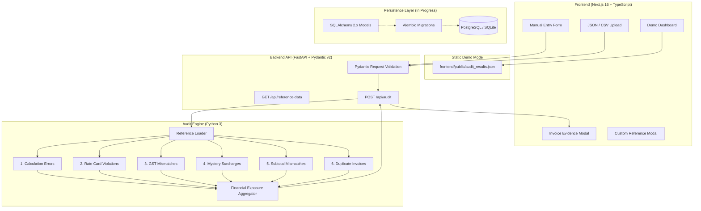

# Invoice Audit Intelligence

**Automated B2B invoice reconciliation, deterministic audit engine, and financial exposure detection platform.**

[](https://github.com/osh-mkumar/invoice-audit-intelligence/actions/workflows/ci.yml)
[](https://invoice-audit-intelligence.vercel.app/)
[](https://github.com/osh-mkumar/invoice-audit-intelligence)

- **Live Application**: [https://invoice-audit-intelligence.vercel.app/](https://invoice-audit-intelligence.vercel.app/)
- **Repository**: [https://github.com/osh-mkumar/invoice-audit-intelligence](https://github.com/osh-mkumar/invoice-audit-intelligence)

---

## Overview

Invoice Audit Intelligence is an automated financial audit and reconciliation platform. It combines a deterministic Python audit engine with an interactive Next.js finance dashboard to identify vendor billing discrepancies, contract rate card violations, statutory tax miscalculations, uncontracted surcharges, subtotal errors, and duplicate billings.

The platform provides two complementary operating modes:
1. **Demo Audit**: An interactive exploration of the precomputed baseline dataset (508 corporate invoices).
2. **Interactive Auditing**: On-demand audit execution via FastAPI for user-submitted invoices via manual web entry or batch file upload (JSON / CSV) against customizable vendor contracts and statutory GST rates.

---

## Baseline Audit Findings (Mosaic Fellowship 2026 Dataset)

Evaluated against the verified benchmark demonstration dataset:

| Metric | Result | Context |
|---|---|---|
| **Invoices Audited** | `508` | Total corporate vendor invoices evaluated |
| **Flagged Invoices** | `65` | `12.8%` of total invoice volume |
| **Invoices with No Issues Detected** | `443` | `87.2%` of invoices passed all checks* |
| **Potential Financial Exposure** | **`₹17,560,098.94`** | Gross quantifiable discrepancy across flagged invoices |
| **Independent Decimal Verification** | **`PASSED`** | Bit-for-bit match via independent script |

*\*Note: "No issues detected" signifies that no discrepancies were triggered by the six deterministic audit rules; it does not constitute a legal or commercial guarantee of invoice correctness.*

### Exposure Breakdown by Category

| Audit Check | Flagged Issues | Potential Exposure | % of Total Exposure |
|---|---|---|---|
| **Duplicate Invoices** | 8 | ₹16,256,034.78 | 92.57% |
| **GST Tax Mismatches** | 15 | ₹1,200,082.26 | 6.83% |
| **Calculation Errors** | 23 | ₹61,181.58 | 0.35% |
| **Mystery Surcharges** | 12 | ₹24,613.97 | 0.14% |
| **Subtotal Mismatches** | 7 | ₹18,186.35 | 0.10% |
| **Rate Card Violations** | 0 | ₹0.00 | 0.00% |
| **Multi-Category Overlaps** | 0 | ₹0.00 | 0.00% |
| **Total** | **65** | **₹17,560,098.94** | **100.0%** |

*Dataset Attribution: Demonstration dataset from the Mosaic Fellowship 2026 invoice auditing challenge.*

---

## Six Deterministic Audit Checks

The audit engine executes six rule-based verification routines without non-deterministic heuristics:

1. **Calculation Errors (`check_calculation_errors`)**  
   Re-computes arithmetic products for each billed line item (`quantity × unit_price`) and flags any line item where the stated amount exceeds the calculated product.
2. **Rate Card Violations (`check_rate_card_violations`)**  
   Cross-references billed unit prices against contracted rate cards for each vendor. Flags contracted items billed at higher rates than agreed.
3. **GST Rate Mismatches (`check_gst_mismatches`)**  
   Verifies billed GST tax percentage bands against statutory tax reference rates mapped to specific HSN/SAC codes (e.g., 5%, 12%, 18%, 28%).
4. **Mystery Surcharges (`check_mystery_surcharges`)**  
   Flags uncontracted line items that do not appear in a contracted vendor's approved rate card schedule, isolating unauthorized fees.
5. **Subtotal Mismatches (`check_subtotal_mismatches`)**  
   Independently sums all line items and compares the result against the invoice stated subtotal to capture unaccounted subtotal adjustments.
6. **Duplicate Invoices (`check_duplicate_invoices`)**  
   Calculates a normalized content fingerprint (vendor, item descriptions, quantities, unit prices, amounts, tax, and totals) to detect duplicate billing submissions regardless of invoice number or date.

---

## System Architecture



---

## Technology Stack

### Frontend Workstation
- **Framework**: Next.js 16 (App Router, Turbopack)
- **Language**: TypeScript 5
- **Styling**: Tailwind CSS v4
- **Charts & UI**: Recharts, Lucide React
- **Deployment**: Vercel

### Backend & Audit Engine
- **Framework**: FastAPI (Asynchronous REST API)
- **Validation**: Pydantic v2 models
- **Precision Arithmetic**: Python `Decimal` (zero floating-point rounding errors)
- **Server**: Uvicorn ASGI

### Persistence & Migrations (Schema Defined)
- **ORM**: SQLAlchemy 2.x declarative models (`Numeric(14, 2)` monetary columns)
- **Driver**: `psycopg` (v3 binary) for PostgreSQL / standard SQLite for test isolation
- **Migrations**: Alembic with batch-mode alter support

### Testing & CI
- **Test Framework**: Pytest 9.x
- **CI Pipeline**: GitHub Actions (Python tests + Next.js production build)
- **Independent Verification**: Script recalculating exact totals from raw JSON records

---

## Key Features

1. **Precomputed Demo Dashboard**: Instant access to the 508-invoice benchmark dataset with KPI summary cards, exposure breakdown, and categorized issue queues.
2. **Interactive Manual Entry**: Form interface for entering single or multi-line invoices with client-side arithmetic validation and vendor autocomplete.
3. **JSON & CSV Batch File Ingestion**: Upload multi-invoice batches in standard formats with sample templates provided for testing.
4. **Custom Reference Rates**: Ability to supply ad-hoc vendor rate cards and HSN GST tax schedules for auditing against custom contracts.
5. **Itemized Evidence Inspector**: Audit findings modal highlighting exact discrepancy values: billed amount, expected amount, rate difference, and financial overcharge.
6. **Separation of Demo and Custom Results**: New user audits compute metrics dynamically from submitted data without mixing into the benchmark baseline.

---

## Local Setup Instructions (Windows PowerShell)

### Prerequisites
- Python 3.10+
- Node.js 18+ and npm
- Git

### 1. Clone the Repository
```powershell
git clone https://github.com/osh-mkumar/invoice-audit-intelligence.git
cd "invoice-audit-intelligence"
```

### 2. Backend Setup
```powershell
# Create and activate a Python virtual environment (optional but recommended)
python -m venv venv
.\venv\Scripts\Activate.ps1

# Install backend dependencies
python -m pip install --upgrade pip
pip install -r requirements-dev.txt

# Run the FastAPI development server
python -m uvicorn backend.main:app --reload --port 8000
```
*The FastAPI backend will be available at [http://127.0.0.1:8000](http://127.0.0.1:8000) with interactive Swagger documentation at [http://127.0.0.1:8000/docs](http://127.0.0.1:8000/docs).*

### 3. Frontend Setup
In a new PowerShell terminal:
```powershell
cd "invoice-audit-intelligence\frontend"

# Install frontend dependencies
npm install

# Start Next.js development server
npm run dev
```
*Open [http://localhost:3000](http://localhost:3000) to view the workstation.*

---

## Testing & Quality Assurance

### Run the Pytest Test Suite
The test suite includes 33 tests covering unit checks, API endpoints, serialization, database models, and full-dataset regression:
```powershell
python -m pytest -v
```

### Run Independent Decimal Verification
Validates that the audit engine's calculations match an independently implemented reference script to the exact cent:
```powershell
python -X utf8 audit/verify.py
```

### Frontend Production Build
Validates TypeScript compilation and static page generation:
```powershell
cd frontend
npm run build
```

### Continuous Integration (GitHub Actions)
Every push and pull request to `main` runs automated CI:
- **Python Unit Tests**: Installs dependencies and runs the complete Pytest suite on Ubuntu.
- **Frontend Production Build**: Installs npm dependencies and validates `npm run build`.

---

## Repository Structure

```text
invoice-audit-intelligence/
├── .github/workflows/
│   └── ci.yml                     # GitHub Actions CI workflow
├── alembic/                       # Alembic database migrations
│   ├── env.py
│   └── versions/                  # Version migration scripts
├── audit/
│   ├── checks.py                  # 6 deterministic audit checks
│   ├── engine.py                  # Audit aggregation engine
│   ├── loader.py                  # Baseline data loader & CLI report
│   ├── generate_results.py        # Generates precomputed demo JSON
│   └── verify.py                  # Independent Decimal verification
├── backend/
│   ├── audit_service.py           # In-memory execution service
│   ├── database.py                # Database connection & session factory
│   ├── main.py                    # FastAPI application & endpoints
│   ├── models.py                  # SQLAlchemy 2.x relational schema
│   └── schemas.py                 # Pydantic request & response models
├── data/
│   ├── finance_invoices.json      # 508 raw benchmark invoices
│   ├── finance_rate_card.json     # Contracted vendor rate cards
│   └── finance_gst_reference.json # Statutory GST rate schedules
├── frontend/
│   ├── app/                       # Next.js App Router pages & API routes
│   ├── components/                # React dashboard & audit components
│   ├── lib/                       # Utility & formatting helpers
│   ├── public/templates/          # Downloadable sample JSON & CSV files
│   └── types/                     # TypeScript definitions
├── tests/
│   ├── test_api.py                # FastAPI endpoint integration tests
│   ├── test_checks.py             # Synthetic unit tests for checks
│   ├── test_database.py           # Relational model & migration tests
│   └── test_full_audit.py         # Full 508-invoice regression assertions
├── alembic.ini                    # Alembic configuration
├── requirements.txt               # Production Python dependencies
├── requirements-dev.txt           # Development & testing dependencies
└── README.md
```

---

## Current Status & Roadmap

- [x] Deterministic 6-check audit engine with Python `Decimal` precision
- [x] Interactive Next.js finance dashboard with categorized queues
- [x] Manual single/multi-line invoice entry and JSON/CSV upload
- [x] FastAPI REST service with Pydantic validation
- [x] Relational database schema (`AuditRun`, `Invoice`, `AuditFinding`, `FindingReview`, `VendorReference`) and Alembic migration
- [ ] End-to-end database persistence for custom audits (Milestone 2)
- [ ] Persistent Audit History sidebar and reopen workflow (Milestone 3)
- [ ] Human review status decisions (*Pending*, *Approved*, *Confirmed Discrepancy*) with decision logs (Milestone 4)
- [ ] Persistent vendor rate card updates and re-audit versioning (Milestone 5)

*Note: The deployed Vercel application showcases the precomputed baseline demonstration. Auditing user-submitted custom invoices requires running the local FastAPI backend (`localhost:8000`). Database persistence and review decision tracking are defined in schema and currently in active implementation.*

---

## License & Attribution

This project was built using the demonstration dataset from the **Mosaic Fellowship 2026** invoice auditing challenge. Intended for technical evaluation and educational demonstration.
