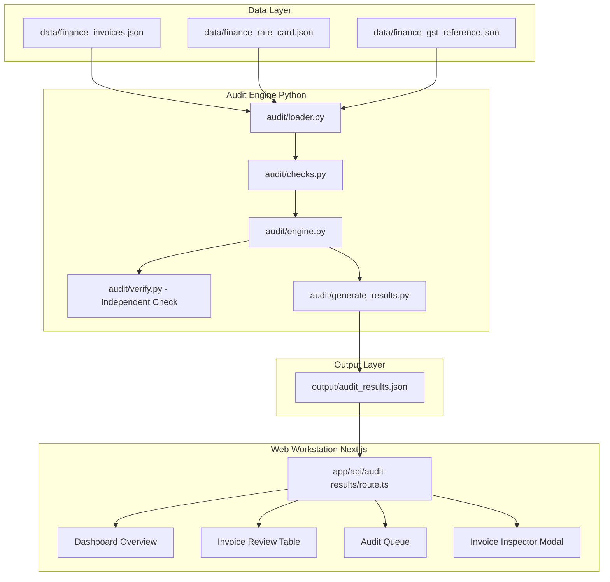

# Invoice Audit Intelligence

**Automated invoice reconciliation and financial exposure detection system for corporate B2B billing.**

## Overview

Invoice Audit Intelligence is a deterministic Python audit engine and Next.js finance workstation designed to automate the discovery of billing errors, rate card violations, GST tax discrepancies, unauthorized surcharges, subtotal errors, and duplicate invoices. By evaluating vendor billing records against contracted rate schedules and statutory tax rates, the system calculates exact financial exposure down to the cent, providing accounting teams with a verified audit trail and an interactive investigation workstation.

---

## Key Audit Results

Across the full dataset, the system achieved the following verified findings:

- **Invoices Audited**: `508`
- **Flagged Invoices**: `65` (12.8% of dataset)
- **Total Verified Overcharge**: **`₹17,560,098.94`**
- **Issue Breakdown**:
  - **Duplicate Invoices**: 8 issues | `₹16,256,034.78` (92.6% of exposure)
  - **GST Mismatches**: 15 issues | `₹1,200,082.26` (6.8% of exposure)
  - **Calculation Errors**: 23 issues | `₹61,181.58` (0.3% of exposure)
  - **Mystery Surcharges**: 12 issues | `₹24,613.97` (0.1% of exposure)
  - **Subtotal Mismatches**: 7 issues | `₹18,186.35` (0.1% of exposure)
  - **Rate Card Violations**: 0 issues | `₹0.00` (0.0% of exposure)
- **Category Overlaps**: `0` (Zero multi-category invoice conflicts)
- **Independent Recalculation Match**: **`PASSED`**

---

## Problem Statement

Enterprise finance and procurement operations process thousands of vendor invoices annually. Manual invoice auditing suffers from several structural vulnerabilities:

1. **Arithmetic Human Error**: Billed line amounts (`quantity × unit_price`) are rarely manually recalculated at scale.
2. **Contract Drift**: Vendors may invoice unapproved items or exceed contracted rate card pricing over long billing cycles.
3. **Statutory Tax Misclassification**: Invoices frequently apply incorrect GST tax percentage bands for specific HSN codes.
4. **Duplicate Submissions**: Identical invoices submitted across different dates or IDs often slip through manual approval workflows.

This system provides automated, deterministic verification across 100% of incoming billing data to eliminate leakage prior to payment disbursement.

---

## Implemented Audit Checks

The audit engine executes six distinct verification routines:

1. **Calculation Errors (`check_calculation_errors`)**:
   Re-computes line item arithmetic (`quantity × unit_price`) and flags any line item where the billed amount exceeds the expected product.
2. **Rate Card Violations (`check_rate_card_violations`)**:
   Compares billed unit prices against contracted rates stored in the vendor rate card, flagging price inflation above agreed contracts.
3. **GST Mismatches (`check_gst_mismatches`)**:
   Cross-references invoice GST tax rates against statutory reference rates mapped to specific HSN codes (e.g., 5%, 12%, 18%, 28%).
4. **Mystery Surcharges (`check_mystery_surcharges`)**:
   Identifies uncontracted line items that do not exist within that vendor's approved rate card schedule and flags the entire billed amount.
5. **Subtotal Mismatches (`check_subtotal_mismatches`)**:
   Sums all line item amounts per invoice and compares the total against the stated invoice subtotal to catch unlisted subtotal markups.
6. **Duplicate Invoices (`check_duplicate_invoices`)**:
   Generates a deterministic fingerprint (vendor name, line item descriptions, quantities, unit prices, amounts, subtotal, GST, total) to catch duplicate billing regardless of invoice ID or date.

---

## System Architecture

The pipeline processes raw data through an audit pipeline before serving formatted findings to the Next.js workstation:



---

## Tech Stack

### Backend & Audit Engine
- **Python 3.14**
- **Pytest 9.1** (Automated unit & regression testing)
- **Decimal Module** (Exact monetary arithmetic)

### Frontend Workstation
- **Next.js 16** (App Router)
- **TypeScript 5**
- **Tailwind CSS v4**
- **Recharts** (Financial exposure visualizer)
- **Lucide React** (UI Iconography)

---

## Project Structure

```text
Invoice Audit Intelligence/
├── audit/
│   ├── checks.py               # 6 core audit check functions
│   ├── engine.py               # Unified audit engine aggregator
│   ├── loader.py               # Data loading & console reporting
│   ├── generate_results.py     # JSON export generator for frontend
│   └── verify.py               # Independent Decimal verification script
├── data/
│   ├── finance_invoices.json       # 508 raw vendor invoices
│   ├── finance_rate_card.json      # 15 vendor contracted rate schedules
│   └── finance_gst_reference.json  # 14 statutory HSN GST tax rates
├── frontend/
│   ├── app/
│   │   ├── api/audit-results/  # Next.js API route serving audit results
│   │   ├── globals.css         # Styling theme
│   │   ├── layout.tsx          # Root layout
│   │   └── page.tsx            # Main audit workstation page
│   ├── components/
│   │   ├── Sidebar.tsx         # Quiet navigation sidebar
│   │   ├── HeroIntro.tsx       # Introduction & pipeline banner
│   │   ├── KPICards.tsx        # Financial exposure & stats cards
│   │   ├── HowItWorksSection.tsx # 4-step workflow guide
│   │   ├── AuditChecksSection.tsx# 6-check category descriptions
│   │   ├── ExposureBreakdownSection.tsx # Financial exposure breakdown & key findings
│   │   ├── InvoiceTable.tsx    # Searchable/filterable flagged invoices table
│   │   ├── IssuesList.tsx      # Audit Queue with Q&A structured findings
│   │   ├── AuditSummarySection.tsx # Formal verification report
│   │   └── InvoiceDetailModal.tsx  # Detailed invoice inspector modal
│   ├── lib/
│   │   └── utils.ts            # Currency formatters & explanation generators
│   ├── types/
│   │   └── audit.ts            # TypeScript interfaces
│   └── package.json
├── output/
│   └── audit_results.json      # Generated audit results file
├── tests/
│   ├── test_checks.py          # Synthetic unit tests for checks
│   └── test_full_audit.py      # Full dataset regression tests
├── requirements-dev.txt        # Development dependencies (pytest)
└── README.md
```

---

## Verification and Testing

The repository contains an automated Pytest test suite covering synthetic unit cases and full-dataset regression tests:

- **Total Test Cases**: `9`
- **Pass Rate**: **`9/9 PASSED`**
- **Independent Verification**: [`audit/verify.py`](file:///d:/projects/Invoice%20Audit%20Intelligence/audit/verify.py) independently recalculates overcharges using Python's `Decimal` module and confirms zero discrepancies against engine output.
- **Verification Status**: **`PASSED`**

---

## Running Locally

### Prerequisites
- Python 3.10+
- Node.js 18+ and npm

### 1. Python Audit Engine & Tests

Install development dependencies:
```bash
python -m pip install -r requirements-dev.txt
```

Run Pytest test suite:
```bash
python -m pytest -v
```

Execute the console audit report:
```bash
python audit/loader.py
```

Run independent verification script:
```bash
python audit/verify.py
```

Generate frontend results file:
```bash
python audit/generate_results.py
```

### 2. Next.js Frontend Workstation

Navigate to frontend directory:
```bash
cd frontend
```

Install dependencies:
```bash
npm install
```

Build production bundle (verify zero TypeScript errors):
```bash
npm run build
```

Start dev server:
```bash
npm run dev
```

Open [http://localhost:3000](http://localhost:3000) in your browser.

---

## Dashboard Features

The web application provides an intuitive finance workstation:

- **Executive Overview**: Prominent display of total verified overcharge (`₹17.56M`) and 4-step workflow explanation.
- **Exposure Breakdown**: Interactive breakdown of overcharges by category with proportional magnitude bars.
- **Key Findings Panel**: Automatically derived insights highlighting the largest exposure (`Duplicate Invoices`) and most frequent issue (`Calculation Errors`).
- **Invoice Investigation Table**: Filter flagged invoices by category or search by Invoice ID/Vendor.
- **Audit Queue**: Dedicated findings queue structuring issues into *What is wrong?*, *What was billed*, *What should have been billed*, and *Financial impact*.
- **Invoice Inspector Modal**: Detailed drill-down view showing invoice metadata, line items, and overcharge parameters.
- **Formal Verification Report**: Independent audit verification matrix displaying category check results.

---

## Design Decisions

1. **Deterministic Engine**: Avoids non-deterministic AI/ML guessing to guarantee 100% mathematical precision for accounting compliance.
2. **Separation of Checks**: Each check function in [`audit/checks.py`](file:///d:/projects/Invoice%20Audit%20Intelligence/audit/checks.py) is modular, stateless, and independently testable.
3. **Regression Safety**: Full dataset regression assertions in [`tests/test_full_audit.py`](file:///d:/projects/Invoice%20Audit%20Intelligence/tests/test_full_audit.py) ensure numerical outputs remain immutable during refactoring.

---

## Future Improvements

- [ ] Automated PDF/CSV invoice parser for ingestion of unstructured billing documents.
- [ ] ERP Integration connectors (SAP / QuickBooks / Tally API integration).
- [ ] Vendor dispute workflow tracking with automated email demand letter generation.

---

## Live Demo

`Live Demo: Coming soon`

---

## Author / Project Context

This project was developed as an independent software engineering initiative focused on automated financial audit systems and data reconciliation using real synthetic billing datasets.
